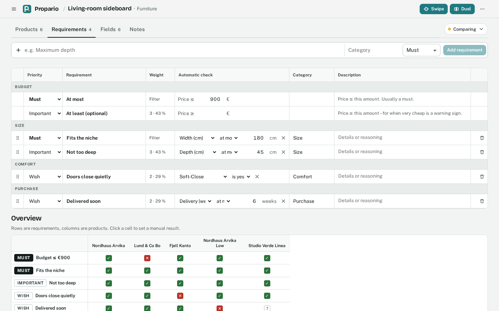
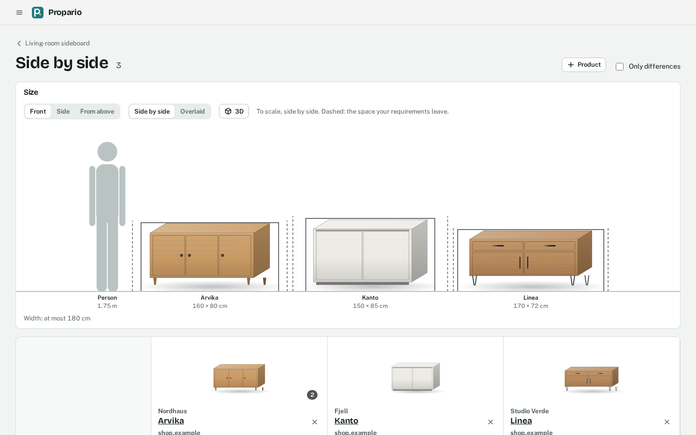
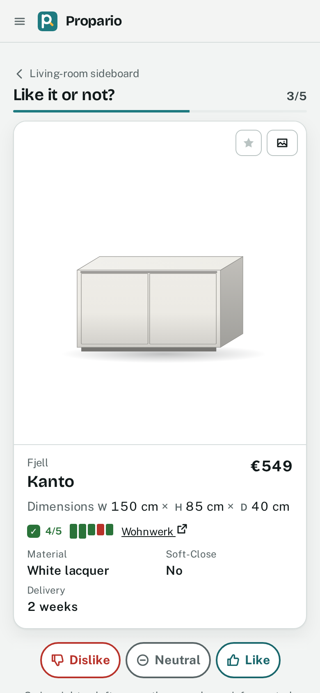
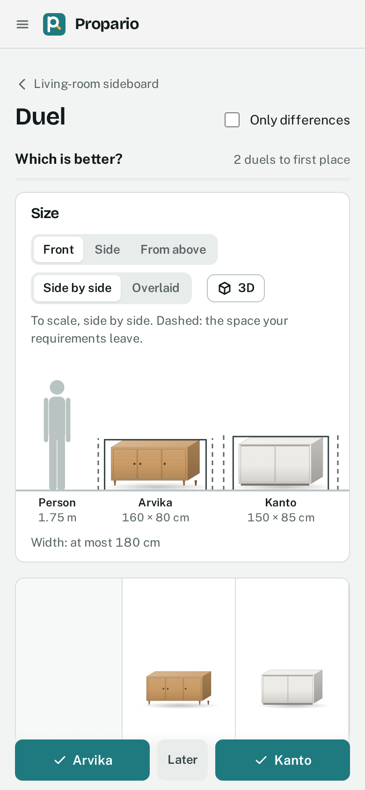

<p align="center">
  
</p>

<h1 align="center">Propario</h1>

<p align="center">
  <strong>Compare products together, and decide.</strong><br>
  A calm, self-hosted place for the purchases that otherwise live in spreadsheets and a dozen open tabs.
</p>

<p align="center">
  <a href="https://github.com/schlatter/propario/actions/workflows/ci.yml"></a>
  <a href="https://github.com/schlatter/propario/releases/latest"></a>
  <a href="LICENSE"></a>
</p>

<p align="center">
  <a href="https://schlatter.github.io/propario/">Website</a> ·
  <a href="docs/user-guide.md">User guide</a> ·
  <a href="docs/self-hosting.md">Self-hosting</a> ·
  <a href="CONTRIBUTING.md">Contributing</a>
</p>

<picture>
  <source media="(prefers-color-scheme: dark)" srcset="docs/images/table-dark.png">
  
</picture>

The sideboard, the laptop, the bike: a bigger purchase means requirements, a handful of
candidates, pictures, prices, dimensions and the opinions of everyone who has to live with it.
Propario keeps all of that in one comparison, checks every product against what you need, and
helps you decide – together, without spreadsheet chaos, without advertising, and on your own
server.

## What it does

**One link is enough.** Paste a shop link and Propario takes the picture, name, price and
dimensions from the page – once, and only what the page states about the product. Or bring
your existing tables from Excel, CSV or the answer of your AI.

**Your requirements check every product.** Set what it must be, what is important, what you
wish for, and a budget. Every product is checked: green met, red not met, grey not known yet.
Missing data never counts against a product.

<picture>
  <source media="(prefers-color-scheme: dark)" srcset="docs/images/requirements-dark.png">
  
</picture>

**Side by side, to scale.** Put candidates next to each other: best values marked, differences
highlighted, and their sizes drawn to scale against the space your requirements leave – in 3D
too, and on a phone right in your room.

<picture>
  <source media="(prefers-color-scheme: dark)" srcset="docs/images/side-by-side-dark.png">
  
</picture>

**Decide together.** Each person swipes through the products – like, neutral, dislike – and
settles the favourites in duels. Everyone's rankings become one joint ranking; its first place
can become your decision. Then the purchase, the return deadline and the warranty stay in view.

<table>
  <tr>
    <td width="50%">
      <picture>
        <source media="(prefers-color-scheme: dark)" srcset="docs/images/phone-swipe-dark.png">
        
      </picture>
    </td>
    <td width="50%">
      <picture>
        <source media="(prefers-color-scheme: dark)" srcset="docs/images/phone-duel-dark.png">
        
      </picture>
    </td>
  </tr>
</table>

**And everything around it**

- **Your AI, if you like:** _Copy for my AI_ hands the comparison to the assistant you already
  use; its answer comes back as a table and updates your products – you see every change first.
- **Offers, tests and reviews:** several shops per product (the cheapest total becomes the
  price), ratings from tests and reviews on one scale, links to price comparisons by GTIN.
- **A table like a spreadsheet:** edit in place, sort, filter with quick chips or a query such
  as `Width <= 90 AND NOT Selection = excluded`, choose and move columns.
- **Installs as an app** on phones and computers; share a product from a shop app straight into
  a comparison.
- **English and German**, light and dark, built and tested for WCAG 2.1 AA.
- **Backups** of everything you can see, pictures included, as one file.

## What it will not do

- **No passwords, no e-mail addresses.** You sign in with a passkey – fingerprint, face or device
  PIN. New people join only with an invitation.
- **No tracking, no advertising, no affiliate links**, no third-party scripts or fonts. Pictures
  are served from your server, so no shop learns who is looking.
- **No crawling.** A product page is read once when you add it, nothing more; shops that refuse
  automated access are respected.
- **Nobody else owns your data.** It stays on your server, encrypted at rest, and every
  comparison is private until you share it.

## Try it

Propario runs in Docker. On your own computer:

```sh
git clone https://github.com/schlatter/propario.git && cd propario
echo "DATA_KEY=$(openssl rand -base64 32)" >> .env   # keep a copy apart from backups
docker compose up -d
docker compose logs app                              # shows the one-time setup link
```

Open the setup link, choose a name and create your passkey. The start page also has
**Try the demo** – three invented comparisons that never leave your browser tab.

For a real instance – HTTPS, your own address, backups, updates – read
[Self-hosting](docs/self-hosting.md).

## Documentation

| For                       | Read                                                                                      |
| ------------------------- | ----------------------------------------------------------------------------------------- |
| Using Propario            | [User guide](docs/user-guide.md)                                                          |
| Running your own instance | [Self-hosting](docs/self-hosting.md)                                                      |
| How tables are imported   | [Excel and table import](docs/excel-import.md)                                            |
| Security and privacy      | [SECURITY.md](SECURITY.md)                                                                |
| Working on the code       | [CONTRIBUTING.md](CONTRIBUTING.md) · [Design guide](docs/brand.md)                        |
| What changed              | [CHANGELOG.md](CHANGELOG.md) · [Releases](https://github.com/schlatter/propario/releases) |

## Status

Early and in daily use. Propario was built for a household comparing purchases together and
grows from real use. Versions follow [Semantic Versioning](https://semver.org); while it is 0.x,
read the [changelog](CHANGELOG.md) before updating.

## Contributing

Ideas, questions and feedback are welcome in
[Discussions](https://github.com/schlatter/propario/discussions), bugs in
[Issues](https://github.com/schlatter/propario/issues). Before writing code, read
[CONTRIBUTING.md](CONTRIBUTING.md) – Propario is small on purpose. Report vulnerabilities
privately, as described in [SECURITY.md](SECURITY.md).

## License

[AGPL-3.0-or-later](LICENSE). Use it, change it, run it for others – and if you run a modified
version as a service, its users are entitled to its source.
