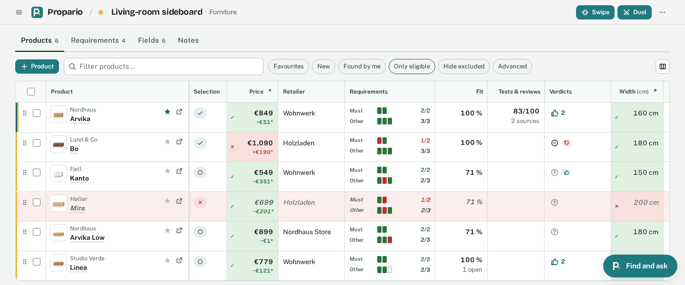

<p align="center">
  
</p>

<h1 align="center">Propario</h1>

<p align="center">
  <strong>Compare faster, decide better.</strong><br>
  Self-hosted · private by default · free software
</p>

<p align="center">
  <a href="https://github.com/schlatter/propario/actions/workflows/ci.yml"></a>
  <a href="https://github.com/schlatter/propario/releases/latest"></a>
  <a href="LICENSE"></a>
</p>

<p align="center">
  <a href="https://schlatter.github.io/propario/">Website</a> ·
  <a href="docs/user-guide.md">User guide</a> ·
  <a href="docs/self-hosting.md">Self-hosting</a> ·
  <a href="CONTRIBUTING.md">Contributing</a>
</p>

<picture>
  <source media="(prefers-color-scheme: dark)" srcset="docs/images/table-dark.png">
  
</picture>

Forget endless lists and a thousand open tabs. Whatever the purchase – sideboard, laptop, bike
and more: Propario lays out the facts nicely and helps you reach a better decision, faster.

## How it works


## What it does

- **One link is enough.** Paste a shop link: Propario takes the picture, price and dimensions
  straight from the shop – or bring your table from Excel or your AI.
- **Define your requirements.** Set what it must be, what you wish for and a budget: every
  product is checked against them – green met, red not met.
- **Side by side, not all over the place.** The candidates side by side: best values shown,
  differences highlighted – and their sizes to scale, in 3D too.
- **Sort out quickly.** Swipe: thumb up or down, each person on their own. What nobody likes is
  sorted out – without a long discussion.
- **Settle it in duels.** Which is better? Propario puts them side by side and asks until your
  ranking stands. On a phone, AR puts them right into your room.
- **Decide together.** Your rankings become one joint ranking – its first place can become your
  decision. Then the purchase, returns and warranty in view.
- **With your AI, if you like.** “Find and ask” searches the shops for more products – or hands
  the comparison to the assistant you already use, for suggestions or your own question. Its
  answer comes back as a table and updates your products – you see every change first.

Also: offers from several shops and ratings from tests and reviews on one scale; a table that
works like a spreadsheet, with filters and queries; Excel, CSV and Markdown import and export;
an installable app that takes products shared from shop apps; English and German, light and
dark; backups of everything you can see, pictures included.

## Private, safe, yours

- Runs on your own server – your data stays with you
- Passkeys instead of passwords
- Stored encrypted, shared only on purpose
- No tracking, no advertising, no affiliate links
- Accessible (WCAG 2.1 AA), free software (AGPL)

New people join only by invitation. A shop page is read once when you add it, never crawled,
and shops that refuse automated access are respected.

## Try it

**In your browser:** the [demo](https://schlatter.github.io/propario/demo/) runs three invented
comparisons right in the page – nothing is saved, nothing is sent anywhere.

**On your own computer**, with Docker:

```sh
git clone https://github.com/schlatter/propario.git && cd propario
echo "DATA_KEY=$(openssl rand -base64 32)" >> .env   # keep a copy apart from backups
docker compose up -d
docker compose logs app                              # shows the one-time setup link
```

Open the setup link, choose a name and create your passkey. For a real instance with HTTPS,
backups and updates, read [Self-hosting](docs/self-hosting.md).

## Documentation

| For                       | Read                                                                                      |
| ------------------------- | ----------------------------------------------------------------------------------------- |
| Using Propario            | [User guide](docs/user-guide.md)                                                          |
| Running your own instance | [Self-hosting](docs/self-hosting.md)                                                      |
| How tables are imported   | [Excel and table import](docs/excel-import.md)                                            |
| Security and privacy      | [SECURITY.md](SECURITY.md)                                                                |
| Working on the code       | [CONTRIBUTING.md](CONTRIBUTING.md) · [Design guide](docs/brand.md)                        |
| What changed              | [CHANGELOG.md](CHANGELOG.md) · [Releases](https://github.com/schlatter/propario/releases) |

## Status and contributing

Early and in daily use: Propario was built for a household comparing purchases together and
grows from real use. Versions follow [Semantic Versioning](https://semver.org); while it is
0.x, read the [changelog](CHANGELOG.md) before updating.

Ideas, questions and feedback are welcome in
[Discussions](https://github.com/schlatter/propario/discussions), bugs in
[Issues](https://github.com/schlatter/propario/issues). Before writing code, read
[CONTRIBUTING.md](CONTRIBUTING.md) – Propario is small on purpose. Report vulnerabilities
privately, as described in [SECURITY.md](SECURITY.md).

## License

[AGPL-3.0-or-later](LICENSE). Use it, change it, run it for others – and if you run a modified
version as a service, its users are entitled to its source.
