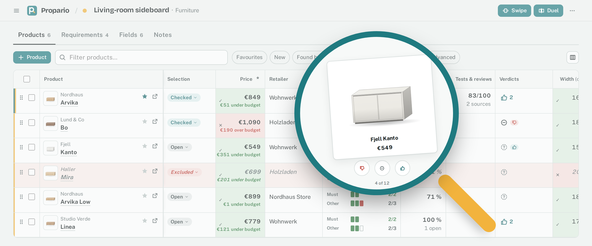

<p align="center">
  
</p>

<h1 align="center">Propario</h1>

<p align="center">
  <strong>Compare faster, decide better.</strong>
</p>

<p align="center">
  <picture><source media="(prefers-color-scheme: dark)" srcset="docs/images/readme/self-hosted-dark.svg"></picture>&emsp;<picture><source media="(prefers-color-scheme: dark)" srcset="docs/images/readme/private-dark.svg"></picture>&emsp;<picture><source media="(prefers-color-scheme: dark)" srcset="docs/images/readme/passkeys-dark.svg"></picture>&emsp;<picture><source media="(prefers-color-scheme: dark)" srcset="docs/images/readme/free-software-dark.svg"></picture>
</p>

<p align="center">
  <a href="https://github.com/schlatter/propario/actions/workflows/ci.yml"></a>
  <a href="https://github.com/schlatter/propario/releases/latest"></a>
  <a href="LICENSE"></a>
  <a href="https://github.com/schlatter/propario/pkgs/container/propario"></a>
</p>

<p align="center">
  <a href="https://schlatter.github.io/propario/demo/"><picture><source media="(prefers-color-scheme: dark)" srcset="docs/images/readme/demo-dark.svg"></picture></a>&ensp;
  <a href="https://schlatter.github.io/propario/">Website</a> ·
  <a href="docs/user-guide.md">User guide</a> ·
  <a href="docs/self-hosting.md">Self‑hosting</a> ·
  <a href="CONTRIBUTING.md">Contributing</a>
</p>

<p align="center">
Forget endless spreadsheets and a thousand open tabs. You do the research and pick the candidates, the others just swipe left or right, and a few duels settle the rest. In the end you have a decision you all stand behind. It works for anything you compare before buying, from a sideboard to a laptop or a used bike, and AI is completely optional.
</p>

<picture>
  <source media="(prefers-color-scheme: dark)" srcset="docs/images/hero-dark.png">
  
</picture>

## How it works

<picture>
  <source media="(max-width: 640px) and (prefers-color-scheme: dark)" srcset="docs/images/readme/how-it-works-narrow-dark.svg">
  <source media="(max-width: 640px)" srcset="docs/images/readme/how-it-works-narrow-light.svg">
  <source media="(prefers-color-scheme: dark)" srcset="docs/images/readme/how-it-works-dark.svg">
  
</picture>

## What it does

- **One link is enough.** Paste a shop link and Propario takes the picture, price and dimensions straight from the shop. Or bring your table from Excel or your AI.
- **Define your requirements.** Set what it must be, what you wish for and a budget. Every product is checked against them: green is met, red is not.
- **Side by side, not all over the place.** The candidates side by side, with the best values shown and the differences highlighted. Their sizes are to scale, in 3D too.
- **Sort out quickly.** Swipe: thumb up or down, each person on their own. What nobody likes is sorted out, without a long discussion.
- **Settle it in duels.** Which is better? Propario puts them side by side and asks until your
  ranking stands. On a phone, AR puts them right into your room.
- **Decide together.** Your rankings become one joint ranking, and its first place can become your decision. After that, the purchase, returns and warranty stay in view.
- **Find more, with your AI if you like.** “Find and ask” searches shops, price comparisons, Kleinanzeigen and mydealz for more products, or hands the comparison to the AI you already use. Any subscription will do. What it suggests comes back as products, and you see every change first.

Also: offers from several shops and ratings from tests and reviews on one scale; a table that
works like a spreadsheet, with filters and queries; Excel, CSV and Markdown import and export;
an installable app that takes products shared from shop apps; English and German, light and
dark; backups of everything you can see, pictures included.

## Why Propario?

|                                                   |  Spreadsheet  | Bookmarks and open tabs | Propario |
| ------------------------------------------------- | :-----------: | :---------------------: | :------: |
| Picture, price and dimensions from a shop link    |    by hand    |            –            |    ✓     |
| Every product checked against your requirements   | with formulas |            –            |    ✓     |
| Sizes to scale: side by side, in 3D, in your room |       –       |            –            |    ✓     |
| Everyone’s verdict, one joint ranking             |    by hand    |            –            |    ✓     |
| Finding more products, with or without AI         |       –       |         by hand         |    ✓     |
| Your data on your own server, encrypted           |    depends    |            –            |    ✓     |

## Private, safe, yours

- Runs on your own server, so your data stays with you
- Passkeys instead of passwords
- Stored encrypted, shared only on purpose
- No tracking, no advertising, no affiliate links
- Accessible (WCAG 2.1 AA), free software (AGPL)

New people join only by invitation. A shop page is read once when you add it, never crawled,
and shops that refuse automated access are respected.

## Try it

**In your browser:** the [demo](https://schlatter.github.io/propario/demo/) runs three invented
comparisons right in the page. Nothing is saved and nothing is sent anywhere.

**On your own computer**, with Docker:

```sh
git clone https://github.com/schlatter/propario.git && cd propario
echo "DATA_KEY=$(openssl rand -base64 32)" >> .env   # keep a copy apart from backups
docker compose up -d
docker compose logs app                              # shows the one-time setup link
```

Open the setup link, choose a name and create your passkey. For a real instance with HTTPS,
backups and updates, read [Self-hosting](docs/self-hosting.md).

## Questions

<details>
  <summary>Is it only for furniture?</summary>
  <p>No, it works for anything you compare before buying: a laptop, a bike, a pram or a used car. Furniture is where Propario was tested first, and where sizes to scale, 3D and the room view help the most.</p>
</details>
<details>
  <summary>Does it compare products or also find them?</summary>
  <p>Comparing and deciding is the focus. “Find and ask” helps you find more products in shops, price comparisons, on Kleinanzeigen and eBay, or with your own AI, and what you find goes straight into your comparison. Propario shows no advertising and has no affiliate links, so nobody earns money from your choice.</p>
</details>
<details>
  <summary>Is there a hosted version I can sign up for?</summary>
  <p>No. Propario is meant to run on your own server, for a household or a group of friends. If someone you know runs an instance, ask them for an invitation.</p>
</details>
<details>
  <summary>What do I need to run it?</summary>
  <p>Docker on a small server or a computer at home. To use it beyond <code>localhost</code>, a hostname with HTTPS, because passkeys require it. It works well behind a VPN, without any public exposure.</p>
</details>
<details>
  <summary>Which shops does it work with?</summary>
  <p>Any shop page that states its product's picture, name or price in a common format. For shops that refuse automated access, Propario takes what the link itself says and you add the rest.</p>
</details>
<details>
  <summary>Does it need AI?</summary>
  <p>No, AI is completely optional and everything works without it. If you like, “Find and ask” hands a comparison to the AI you already use, and its answer comes back only after you have seen every change.</p>
</details>
<details>
  <summary>Can I use my ChatGPT Plus or Claude Pro subscription?</summary>
  <p>Yes, by copying: “Find and ask” copies the comparison for your chat and takes its answer back. Asking from within Propario needs an API key with credit from the provider, and a chat subscription does not include one.</p>
</details>
<details>
  <summary>Can I bring my existing spreadsheets?</summary>
  <p>Yes. Excel, CSV and Markdown tables are imported with a preview of every column; unknown columns become fields, nothing is dropped. You can export to Excel and JSON at any time.</p>
</details>
<details>
  <summary>What does it cost?</summary>
  <p>Nothing. Propario is free software under the AGPL-3.0. If you run a modified version for others, they are entitled to its source.</p>
</details>

## Documentation

| For                       | Read                                                                                      |
| ------------------------- | ----------------------------------------------------------------------------------------- |
| Using Propario            | [User guide](docs/user-guide.md)                                                          |
| Running your own instance | [Self-hosting](docs/self-hosting.md)                                                      |
| How tables are imported   | [Excel and table import](docs/excel-import.md)                                            |
| Security and privacy      | [SECURITY.md](SECURITY.md)                                                                |
| Working on the code       | [CONTRIBUTING.md](CONTRIBUTING.md) · [Design guide](docs/brand.md)                        |
| What changed              | [CHANGELOG.md](CHANGELOG.md) · [Releases](https://github.com/schlatter/propario/releases) |

## Status and contributing

Early and in daily use: Propario was built for a household comparing purchases together and
grows from real use. Versions follow [Semantic Versioning](https://semver.org); while it is
0.x, read the [changelog](CHANGELOG.md) before updating.

Ideas, questions and feedback are welcome in
[Discussions](https://github.com/schlatter/propario/discussions), bugs in
[Issues](https://github.com/schlatter/propario/issues). Before writing code, read
[CONTRIBUTING.md](CONTRIBUTING.md), because Propario is small on purpose. Report vulnerabilities
privately, as described in [SECURITY.md](SECURITY.md).

## License

[AGPL-3.0-or-later](LICENSE). Use it, change it, run it for others. If you run a modified
version as a service, its users are entitled to its source.
