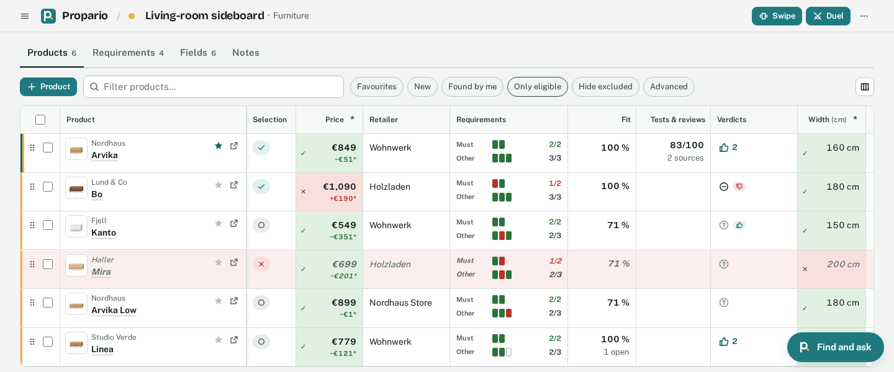
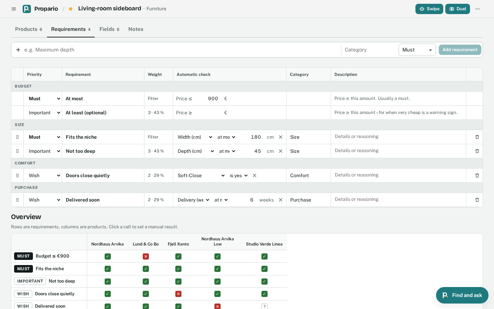
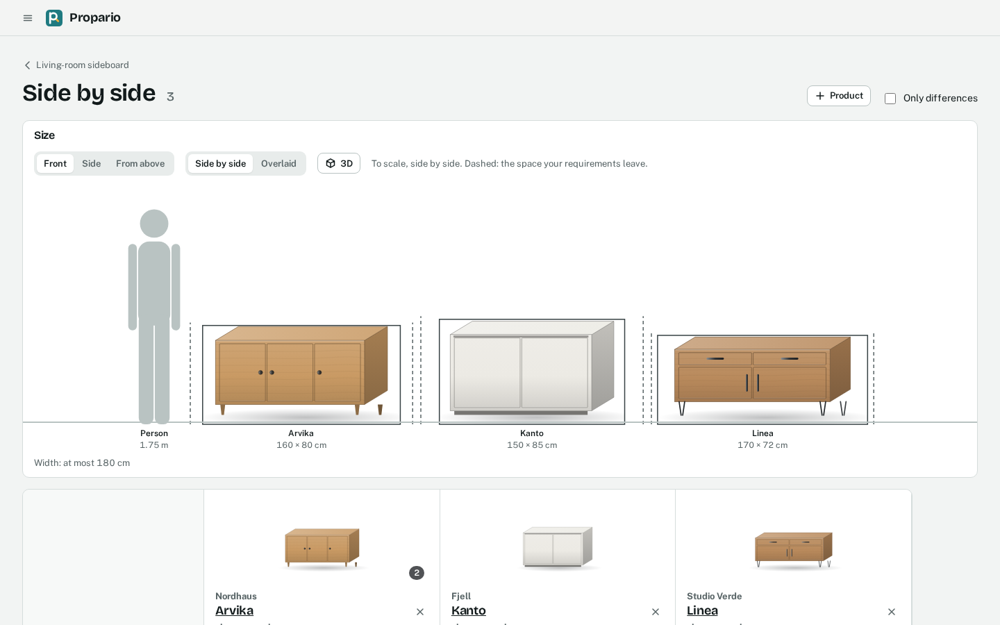
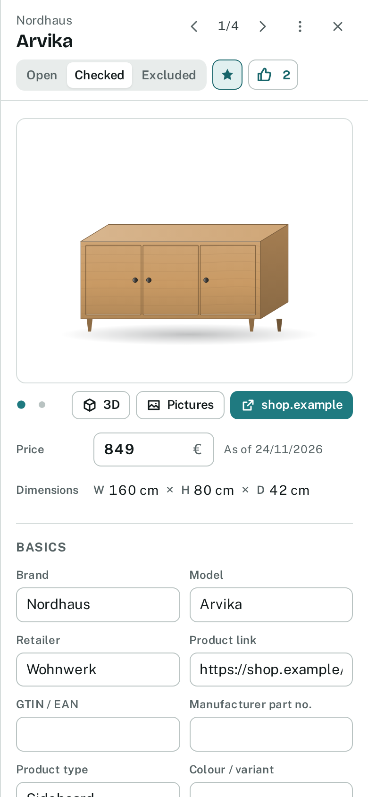

# User guide

How to use Propario, from the first sign-in to the decision. The interface is in English and
German; this guide uses the English labels. To try everything without an account, open the
[demo](https://schlatter.github.io/propario/demo/) or **Try the demo** on your instance's start
page – its comparisons are invented and stay in your browser tab.

- [Getting in](#getting-in)
- [Comparisons](#comparisons)
- [Products](#products)
- [Fields](#fields)
- [Requirements](#requirements)
- [Deciding](#deciding)
- [Sharing](#sharing)
- [Importing tables and working with your AI](#importing-tables-and-working-with-your-ai)
- [Backup and restore](#backup-and-restore)
- [Settings](#settings)
- [On your phone](#on-your-phone)
- [When something does not work](#when-something-does-not-work)

## Getting in

Propario has no passwords. You sign in with a **passkey** – your fingerprint, face or device PIN.

1. Open the invitation link you were sent (each works once and for 14 days).
2. Choose your name and select **Create passkey and join**.
3. Propario shows your **recovery key**, once. Write it down or put it in your password manager:
   it is the only way back in if all your passkeys are lost.

On another device, sign in with the passkey from your phone, or add a passkey for that device
under _Settings → Passkeys_. Lost your passkeys? Choose **Lost your passkey? Use your recovery
key** on the sign-in page; the used key is replaced by a new one.

## Comparisons

A **comparison** is one purchase: the sideboard, the laptop, the bike. _Comparisons_ lists yours
and the ones shared with you; search across comparisons and products, filter by category, and
show archived ones.

- **New comparison:** a name and, if you like, a category.
- **Stage:** each comparison moves from _Researching_ to _Comparing_, _Decided_ and _Purchased_.
  Set it in the menu next to the tabs.
- **⋯ menu:** edit _Name & category_, _Duplicate_, _Archive_, _Export_ (JSON or Excel),
  _Share comparison_, _Add or update products_, _Delete_.
- **Tabs:** _Products_, _Requirements_, _Fields_ and _Notes_ (the goal of the purchase, the
  current system, reference links – anything that does not belong to one product).

## Products

**Add a product** with **+ Product**: type a name, or paste a shop link and press Enter.
With a link, Propario reads the page once and fills what it states about the product – picture,
name, brand, price, dimensions, data sheet. Shops that refuse automated access are respected;
Propario then takes what the address itself says, and you can paste or drop a picture
yourself.

**The table** works like a spreadsheet:

- Edit a cell in place; sort by a column; drag rows to put them in your order.
- **Columns** chooses what is shown; drag a column edge to resize it, double-click to fit.
- **Quick filters:** _Favourites_, _New_, _Found by me_, _Only eligible_ (meets all must
  criteria), _Hide excluded_.
- **Advanced** filters with a query over any field, for example
  `Price < 800 AND NOT Selection = excluded` or `Fit >= 70 AND Eligible = yes`. Combine with
  `AND`, `OR`, `NOT` and brackets; quote names with spaces. The help next to the field lists
  every field you can use.

**Details:** select a product's name. The details show its pictures, price (with the date it was
seen – older than a week is marked), dimensions and every field, and the sections:

- **Pictures:** swipe or use the arrows; paste a picture anywhere in the details with Ctrl+V.
  _Update pictures_ adds, removes or picks the main picture; _Set for 3D_ marks a picture as the
  front, side or a dimension drawing.
- **Offers:** what different shops ask. The cheapest total including shipping becomes the price.
- **Tests & reviews:** ratings from tests and reviews, converted to one scale; product and shop
  ratings are kept apart. Links to price comparisons use the GTIN when there is one.
- **Decision & purchase:** _Final decision_, the purchase date, and the return and warranty
  dates suggested from it.

Step through the products with the arrows at the top of the details.

## Fields

Fields are the columns of a comparison; each comparison has its own. A field has a type – text,
number (with a unit), yes/no, date, choice, rating or link – and can say whether **smaller or
larger is better**. In _Side by side_ the best value then shows green and the worst red.
_Quick add_ offers common fields such as width, height, depth and weight.

## Requirements

Requirements say what the purchase has to do. Each has a **priority**:

| Priority      | Meaning                                 |
| ------------- | --------------------------------------- |
| **Must**      | Products that fail it are not eligible. |
| **Important** | Should be met.                          |
| **Wish**      | Nice to have.                           |
| **Bonus**     | An extra plus.                          |
| **Exclusion** | Describes what rules a product out.     |
| **Avoid**     | Describes something unwanted.           |
| **Info**      | A note only, not checked.               |

Give a requirement an **automatic check** – a field, a comparison and a value, such as
_Width (cm) at most 180_ – and every product is checked: **green** met, **red** not met,
**grey** not known yet. Missing data never counts against a product. Without a check, or to
overrule it, select the result and set it by hand (met → not met → automatic). The budget is a
requirement too: at most, and optionally at least.

**Fit** is the weighted share of met requirements that are not musts (important 3, wish 2,
bonus 1, avoid 2). The **Overview** under the requirements shows every product against every
requirement at a glance.

## Deciding

On your own or with others: everyone on a comparison judges for themselves, and Propario brings
their judgements together.

- **Selection:** each product is _Open_, _Checked_ or _Excluded_. Excluding asks for a reason
  (looks, size, price, brand, shop, quality, reviews, other), which you can filter by later.
- **Favourite:** the star marks your favourites.
- **Verdict:** _I like it_, _Neutral_ or _I don't like it_ – yours, next to everyone else's.
- **Swipe:** go through the products one by one and like them or not – swipe, or use the arrow
  keys (↓ for neutral). At the end you see what everyone likes.
- **Duel:** two at a time – which is better? After a few duels your ranking stands. Duels are
  between your favourites and what everyone likes. Everyone's rankings become the **joint
  ranking**; its first place can become the decision.
- **Side by side:** select products in the table and **Compare**. Best values are marked,
  _Only differences_ hides what is the same, and **Size** draws the products to scale next to
  a person and the space your requirements leave – from the front, the side or above, side by
  side or overlaid, and in **3D**. On a phone that supports it, **View in your room** puts a
  product into your room.

When you have decided, mark the product as the **Final decision** in its details and record the
purchase; the comparison's stage follows.

## Sharing

Comparisons are private. To share one, open **⋯ → Share comparison** and choose for each person
**Can view** or **Can edit**; **No access** takes it back. Only people with an account on your
instance can be chosen – the person who looks after the instance invites them under
_Settings → People on this instance_. A comparison shared for viewing shows _View only_.

## Importing tables and working with your AI

**A new comparison from a table:** _Import_ → choose an Excel, CSV, Markdown, text or JSON file.
Each sheet becomes a comparison. The wizard shows the detected header row, what each column
becomes, the requirements and notes found below the products, and a preview – correct anything
before importing. Nothing is dropped silently: unknown columns become fields, values that do not
fit are kept as text. Details: [Excel and table import](excel-import.md).

**Into an existing comparison:** **⋯ → Add or update products**, then paste a table or choose a
file. A row with the same link, GTIN or name updates that product; the others are added; empty
cells change nothing. You see every change before it is saved.

**Find and ask** – the button bottom right in a comparison:

- **Search the shops:** Geizhals, idealo and Amazon, searched for the type of product you compare or
  any words you type; the search opens in a new tab and Propario adds no tracking. Found one?
  Paste its link into the field below.
- **With your AI:** _Ask my AI for more_ copies the comparison – requirements, products, what is
  not met or not known – with a request for up to five more products; _Copy for my AI_ copies it
  with your own question, or, without one, asks which product fits best. Paste it into the
  assistant you use. If it adds products or fills in values, it answers with the products as a
  table; paste that back with _Add or update products_. Propario itself sends nothing anywhere.
- To pick out products by their values – less than 40 cm deep, under €800 – the table's
  **Advanced** filter answers at once, without AI.

## Backup and restore

Your comparisons are stored on the server. Under **Backup**:

- **Download backup** saves everything you can see – comparisons, products, fields,
  requirements, ratings, decisions and pictures – in one JSON file.
- **Restore** loads such a file or a single exported comparison: **Add to my comparisons** keeps
  what you have and adds copies; **Replace my comparisons** deletes the comparisons you own and
  adds the backup.

## Settings

- **Account:** your name (shown to people you share with), your **passkeys** (add one per
  device), a new **recovery key**, sign out here or on all devices, and deleting your account.
- **People on this instance** _(for the person who looks after it)_: invitation links, open
  invitations, removing accounts.
- **Language** and **Appearance** (system, light or dark).
- **People:** the names used for ratings and “found by”.
- **About:** the running version, and links to this guide and to the source code.
- **Troubleshooting:** see below.

## On your phone

Propario installs as an app: on Android choose **Install app**, on iPhone **Share → Add to Home
Screen**. Installed, a product link shared from a shop app can go straight into a comparison:
**Share → Propario**, then pick the comparison.

## When something does not work

- **Propario does not start:** after a few seconds the page says where it stopped. **Reload**, or
  **Reset this browser** – it removes only Propario's copy in this browser; you stay signed in
  and everything is loaded again from the server.
- **Something odd on one device:** _Settings → Troubleshooting_ → switch on the detailed log, use
  Propario until it happens, then **Download support package** and pass it to whoever runs your
  instance. It holds technical details only, no contents of your comparisons.
- **“Not in the demo”:** reading shop pages and sharing need a real account.
